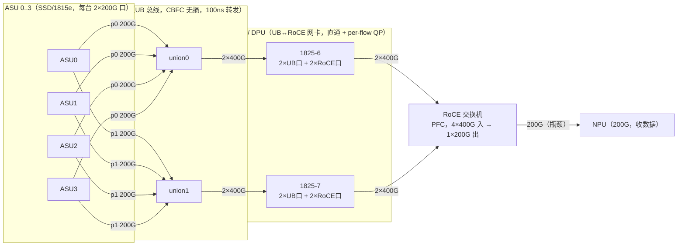
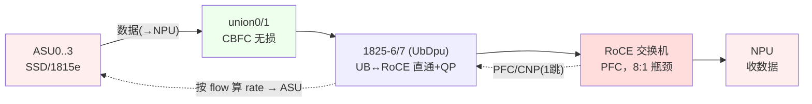
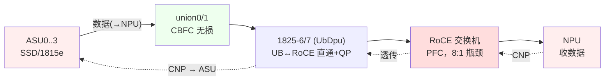
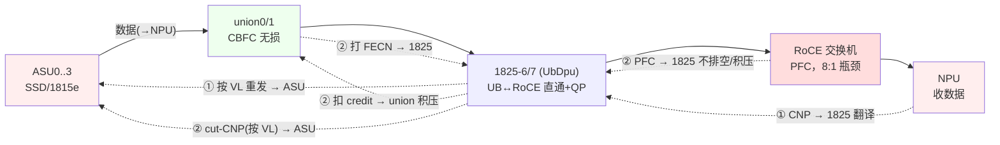
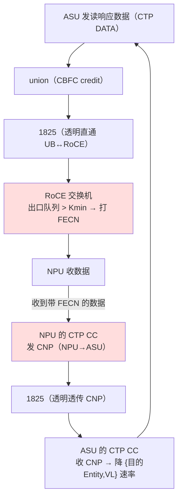
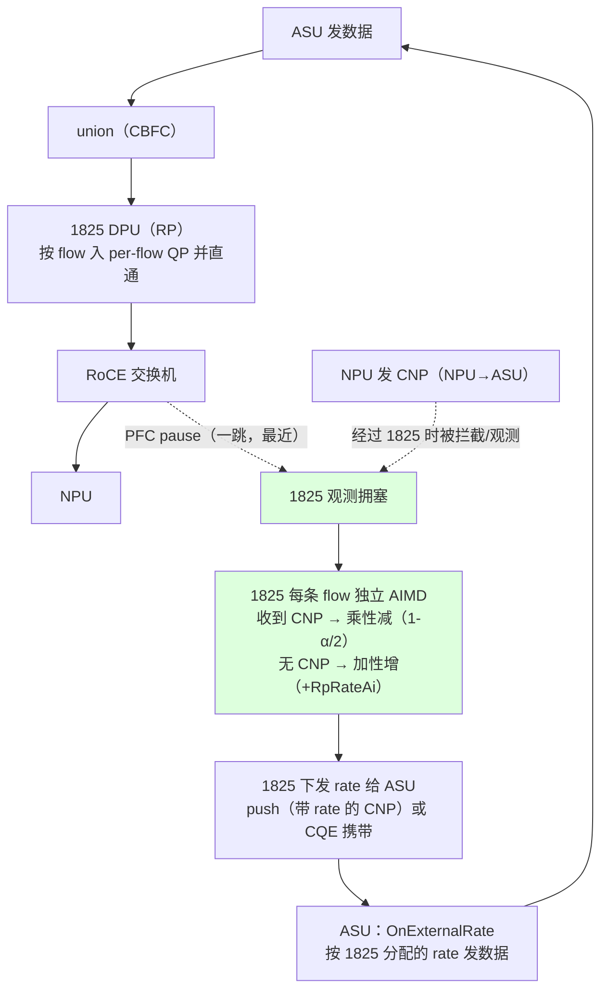

# KV Cache 卸载：两套拥塞控制方案 + IO 大小扫描

本文给出该场景的拓扑、方案1（1825 RP）/ 方案2（transparent CTP CC）的流程图，以及
这两套方案在不同 IO 大小下的实测性能。背景与排障细节见
`kv-cache-offload-ub-roce.md` 与 `kv-cache-offload-ub-roce-findings.md`。

## 1. 拓扑（4 ASU / 2 union / 2×1825 / 1 NPU，8:1 汇聚）



- 每个 ASU 两个口：`p0→union0`、`p1→union1`。
- `union0→1825-6`、`union1→1825-7`，各自 2 条 400G。
- 4 ASU×2 口（200G）= 8 条 200G 流汇到 1 个 200G 的 NPU → **8:1 超订**，拥塞点在
  RoCE 交换机出口与 NPU 入口。
- UB 侧无损靠 **CBFC credit**，RoCE 侧无损靠 **PFC**。

### 1.1 三方案的信号方向（分三张图，叠加在拓扑上）

每张图：实线=数据方向（ASU→NPU，左→右）；虚线=该方案的拥塞反馈方向。

**方案1 · 1825 RP（短环，近拥塞点）**



1825 一跳就近感知 RoCE 拥塞 → 就地 per-flow AIMD → rate 下发 ASU。

**方案2 · transparent（长环，端到端 CTP CC）**



NPU 的 CNP 经 RoCE 交换机、1825（透传）一路回 ASU；反馈横跨整条 ASU↔NPU。

**方案3 · graded / c（逐级，两条路径都在）**



① 1825 把 RoCE 的 CNP 按 VL 翻译重发给 ASU；② 1825 因 PFC 不排空 buffer 积压、扣 UB credit → union 队列涨打 FECN → 1825 再按 VL 给 ASU 发 cut-CNP。

## 2. 方案2：transparent + 端到端 CTP CC（长链路闭环）

1825 是纯透明转发；拥塞信号（FECN/CNP）由两端 Host 的 CTP CC 处理，反馈要走完整条环。



- 反馈路径长（ASU↔NPU 来回），收敛慢。
- 1825 不参与控速，只转发。
- 优点：0 丢包（PFC 无损）；缺点：大 IO 下 incast 易饿死个别流，尾延拉长。

## 3. 方案1：1825 RP（近拥塞点反应，短链路闭环）

1825 作为 RoCE 反应点：就地观测拥塞（下游 PFC 一跳、或拦 CNP），对**每条
{源ASU, 目的NPU, VL} flow 独立做 AIMD**，再把 rate 下发回 ASU（push 带 rate 的 CNP，
或 CQE 携带）。



- 拥塞信号在 1825 就地处理（离瓶颈一跳），rate 立刻下发 ASU → 反馈快、收敛快。
- 每条 flow 独立控速，重流不会连累同 NPU 下的受害流。
- 兜底：`RpCqeFallbackEnabled` 对长时间无 CQE 的流主动补推一次 rate。

## 4. IO 大小扫描结果

拓扑：4 ASU / 2 union / 2×1825 / 1 NPU（8:1），`--transport-mode CTP`，每 ASU 2 口。
8 个读任务的完成时间分布（µs）+ 有效聚合吞吐（= 总字节 / makespan；小 IO makespan 极小时该值偏乐观）。
方案：s1=`--dpu-role rp --rp-push`，s2=`--dpu-role transparent`，s3=`--dpu-role transparent --graded-backpressure`。

| IO | 方案 | 丢包 | min | p50 | p99 | max | 吞吐(Gbps) |
|----|------|------|-----|-----|-----|-----|-----------|
| 32KB | s1 | 8 | 6 | 8 | 11 | 11 | 186.1 |
| 32KB | s2 | **0** | 6 | 8 | 11 | 11 | 186.1 |
| 32KB | s3 | **0** | 6 | 8 | 11 | 11 | 186.1 |
| 64KB | s1 | 8 | 11 | 15 | 57 | 57 | 74.0 |
| 64KB | s2 | **0** | 11 | 15 | 57 | 57 | 74.0 |
| 64KB | s3 | 8 | 11 | 15 | 57 | 57 | 74.0 |
| 128KB | s1 | 24 | 56 | 59 | 65 | 65 | 128.8 |
| 128KB | s2 | **0** | 56 | 59 | 65 | 65 | 128.8 |
| 128KB | s3 | 8 | 56 | 59 | 65 | 65 | 128.8 |
| 256KB | s1 | 40 | 34 | 80 | 117 | 117 | 143.0 |
| 256KB | s2 | **0** | 32 | 55 | 86 | 86 | **196.1** |
| 256KB | s3 | 8 | 25 | 68 | 86 | 86 | 194.2 |
| 512KB | s1 | 140 | 114 | 144 | 763 | 763 | 44.0 |
| 512KB | s2 | **0** | 65 | 110 | 183 | 183 | **183.2** |
| 512KB | s3 | 18 | 53 | 153 | 214 | 216 | 155.0 |
| 1MB | s1 | 200 | 115 | 730 | 1768 | 1768 | 38.0 |
| 1MB | s2 | **0** | 84 | 306 | 1594 | 1600 | **41.9** |
| 1MB | s3 | 2 | 183 | 1015 | 2891 | 2892 | 23.2 |
| 2MB | s1 | 280 | 1192 | 2351 | 3347 | 3347 | 40.1 |
| 2MB | s2 | **0** | 343 | 2730 | 5939 | 5944 | 22.6 |
| 2MB | s3 | **0** | 384 | 2886 | 5616 | 5616 | 23.9 |
| 4MB | s1 | 372 | 2919 | 4372 | 5695 | 5696 | **47.1** |
| 4MB | s2 | **0** | 2005 | 7155 | 11577 | 11579 | 23.2 |
| 4MB | s3 | **0** | 1660 | 5612 | 9530 | 9530 | 28.2 |
| 8MB | s1 | 532 | 5397 | 7312 | 9129 | 9129 | **58.8** |
| 8MB | s2 | **0** | 7352 | 12647 | 17593 | 17594 | 30.5 |
| 8MB | s3 | **0** | 3980 | 9527 | 15097 | 15098 | 35.6 |

复现命令：

```bash
# 方案2
python3 scratch/kv-offload-incast/gen_case.py --output-dir <CASE> \
  --asu-count 4 --union-count 2 --npu-count 1 --asu-bw 200Gbps --fabric-bw 400Gbps \
  --kv-bytes <SIZE> --transport-mode CTP --dpu-role transparent
# 方案1
python3 scratch/kv-offload-incast/gen_case.py --output-dir <CASE> \
  --asu-count 4 --union-count 2 --npu-count 1 --asu-bw 200Gbps --fabric-bw 400Gbps \
  --kv-bytes <SIZE> --transport-mode CTP --dpu-role rp --rp-push
./build/scratch/ns3.44-ub-quick-example --case-path=<CASE>
```

### 结论

- **≤256KB**：三者几乎一样（SSD 50µs 延迟/建立开销主导；makespan 极小时吞吐数字偏乐观）。
  s2/s3 基本 0（或极少）丢包，s1 有零星丢包（8→40）。（注：8 个流时 p99≈max。）
- **512KB–1MB**：**s2 吞吐/p99 最好**——s3 此时把 RoCE CNP 翻译给 ASU、降速更早，反而偏慢；s1 丢包多、吞吐低。
- **≥2MB**：**s3(c) 的 p99/尾延最低**（无损反压 + CNP 翻译压住了 incast 里的饿死流）；s1 吞吐最高
  但代价是丢包（8→532）；s2 尾延最差（有流饿死，p99 与 max 一起被拉高）。
- 一句话：小 IO 三者持平；中 IO 简单透明的 s2 最优；大 IO s3 赢在尾延/公平，s1 赢在吞吐但丢包。

## 5. 已知问题（影响上表方案1 的绝对数字）

- 方案1 的丢包（40→532）**大概率**来自 union 上的 `route cannot be found`：RP 下发的
  rate/CNP 也是「NPU→ASU 通配目的端口」的包，撞上和读请求同一个 union 通配路由问题
  （union 路由表按 ASU 物理端口写死，通配/entity 选端口与落到哪个 union 不一致，详见
  findings 的排障记录）。修掉该路由问题前，方案1 的丢包数字不能算干净。
- 上表 `--dpu-role rp --rp-push` 是「周期 push rate」变体；另有 `--cqe`（CQE 携带 rate）
  变体，二者同为 1825 RP，本次未单独列列。