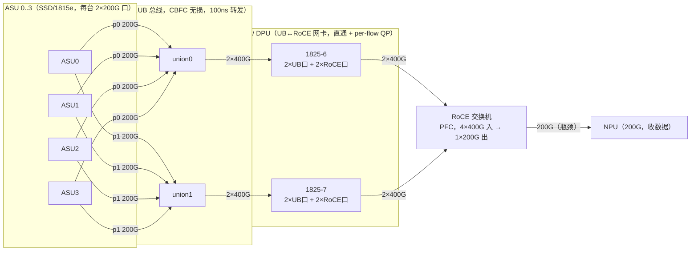
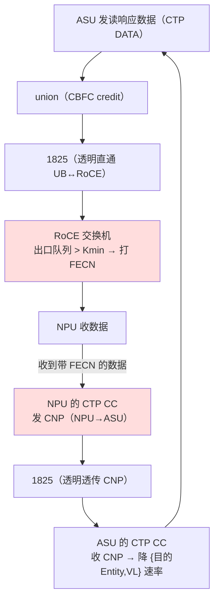
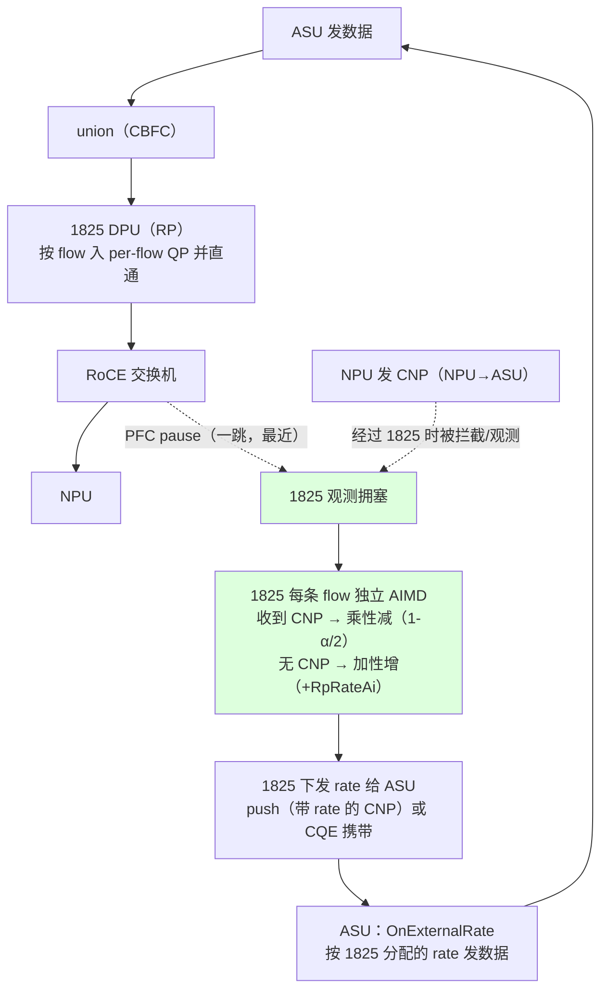

# KV Cache 卸载：两套拥塞控制方案 + IO 大小扫描

本文给出该场景的拓扑、方案1（1825 RP）/ 方案2（transparent CTP CC）的流程图，以及
这两套方案在不同 IO 大小下的实测性能。背景与排障细节见
`kv-cache-offload-ub-roce.md` 与 `kv-cache-offload-ub-roce-findings.md`。

## 1. 拓扑（4 ASU / 2 union / 2×1825 / 1 NPU，8:1 汇聚）



- 每个 ASU 两个口：`p0→union0`、`p1→union1`。
- `union0→1825-6`、`union1→1825-7`，各自 2 条 400G。
- 4 ASU×2 口（200G）= 8 条 200G 流汇到 1 个 200G 的 NPU → **8:1 超订**，拥塞点在
  RoCE 交换机出口与 NPU 入口。
- UB 侧无损靠 **CBFC credit**，RoCE 侧无损靠 **PFC**。

## 2. 方案2：transparent + 端到端 CTP CC（长链路闭环）

1825 是纯透明转发；拥塞信号（FECN/CNP）由两端 Host 的 CTP CC 处理，反馈要走完整条环。



- 反馈路径长（ASU↔NPU 来回），收敛慢。
- 1825 不参与控速，只转发。
- 优点：0 丢包（PFC 无损）；缺点：大 IO 下 incast 易饿死个别流，尾延拉长。

## 3. 方案1：1825 RP（近拥塞点反应，短链路闭环）

1825 作为 RoCE 反应点：就地观测拥塞（下游 PFC 一跳、或拦 CNP），对**每条
{源ASU, 目的NPU, VL} flow 独立做 AIMD**，再把 rate 下发回 ASU（push 带 rate 的 CNP，
或 CQE 携带）。



- 拥塞信号在 1825 就地处理（离瓶颈一跳），rate 立刻下发 ASU → 反馈快、收敛快。
- 每条 flow 独立控速，重流不会连累同 NPU 下的受害流。
- 兜底：`RpCqeFallbackEnabled` 对长时间无 CQE 的流主动补推一次 rate。

## 4. IO 大小扫描结果

拓扑：4 ASU / 2 union / 2×1825 / 1 NPU（8:1），`--transport-mode CTP`，每 ASU 2 口。
表中 `min/median/max` 为 8 个读任务的完成时间分布（µs）。

| IO | 方案 | 丢包 | min | median | max（尾延） |
|----|------|------|-----|--------|-------------|
| 256KB | 方案2 transparent | **0** | 30 | 67 | 86 |
| 256KB | 方案1 rp-push | 40 | 34 | 84 | 117 |
| 512KB | 方案2 | **0** | 59 | 132 | 183 |
| 512KB | 方案1 | 140 | 114 | 158 | 763 |
| 1MB | 方案2 | **0** | 87 | 347 | 1672 |
| 1MB | 方案1 | 200 | 115 | 755 | 1768 |
| 2MB | 方案2 | **0** | 341 | 3660 | 7085 |
| 2MB | 方案1 | 280 | 1192 | 2919 | **3347** |
| 4MB | 方案2 | **0** | 1982 | 7339 | 11609 |
| 4MB | 方案1 | 372 | 2919 | 5397 | **5696** |
| 8MB | 方案2 | **0** | 7339 | 13705 | 17610 |
| 8MB | 方案1 | 532 | 5397 | 8929 | **9129** |

复现命令：

```bash
# 方案2
python3 scratch/kv-offload-incast/gen_case.py --output-dir <CASE> \
  --asu-count 4 --union-count 2 --npu-count 1 --asu-bw 200Gbps --fabric-bw 400Gbps \
  --kv-bytes <SIZE> --transport-mode CTP --dpu-role transparent
# 方案1
python3 scratch/kv-offload-incast/gen_case.py --output-dir <CASE> \
  --asu-count 4 --union-count 2 --npu-count 1 --asu-bw 200Gbps --fabric-bw 400Gbps \
  --kv-bytes <SIZE> --transport-mode CTP --dpu-role rp --rp-push
./build/scratch/ns3.44-ub-quick-example --case-path=<CASE>
```

### 结论

- **小 IO（256–512KB）**：两者都很快；256KB 方案2 略优，512KB 方案1 尾延反而更差
  （763 vs 183µs，控速开销占比大）。
- **中大 IO（≥2MB）**：方案1 的尾延/makespan 约为方案2 的 **一半**，说明 1825 RP 的
  per-flow 控速压制了 incast 里的饿死流，使任务完成时间分布更均衡；方案2 虽 0 丢包，但
  min/max 拉得很开（有流被饿死）。
- **趋势**：1825 RP 的优势随 IO 增大而显现（反馈距离/公平分配的价值随拥塞程度放大）。

## 5. 已知问题（影响上表方案1 的绝对数字）

- 方案1 的丢包（40→532）**大概率**来自 union 上的 `route cannot be found`：RP 下发的
  rate/CNP 也是「NPU→ASU 通配目的端口」的包，撞上和读请求同一个 union 通配路由问题
  （union 路由表按 ASU 物理端口写死，通配/entity 选端口与落到哪个 union 不一致，详见
  findings 的排障记录）。修掉该路由问题前，方案1 的丢包数字不能算干净。
- 上表 `--dpu-role rp --rp-push` 是「周期 push rate」变体；另有 `--cqe`（CQE 携带 rate）
  变体，二者同为 1825 RP，本次未单独列列。